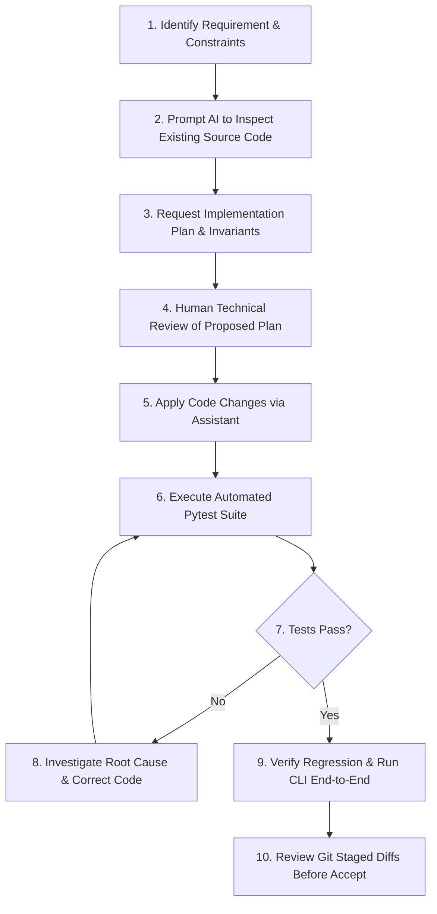
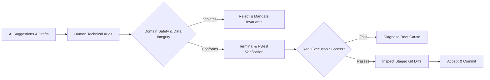

# AI Usage Documentation — Thelawala Search Engine

## Table of Contents

- [1. Executive Summary and Purpose](#1-executive-summary-and-purpose)
- [2. AI Tools and Development Workflow](#2-ai-tools-and-development-workflow)
  - [2.1 Confirmed AI Tooling Environment](#21-confirmed-ai-tooling-environment)
  - [2.2 Standard Development Protocol](#22-standard-development-protocol)
- [3. Chronological Development Phases and AI Assistance](#3-chronological-development-phases-and-ai-assistance)
  - [Phase 0 — Repository and Data Inspection](#phase-0--repository-and-data-inspection)
  - [Phase 1 — Data Cleaning and Normalization](#phase-1--data-cleaning-and-normalization)
  - [Phase 2 — Search Log Mining and Synonym Discovery](#phase-2--search-log-mining-and-synonym-discovery)
  - [Phase 3 — Search Engine and BM25 Ranking](#phase-3--search-engine-and-bm25-ranking)
  - [Phase 4 — CLI and Batch Search Interface](#phase-4--cli-and-batch-search-interface)
  - [Phase 5 — Evaluation and Testing Pipeline](#phase-5--evaluation-and-testing-pipeline)
  - [Phase 6 — Documentation and Original Release Preparation](#phase-6--documentation-and-original-release-preparation)
  - [Phase 7 — Sponsored Product Priority (Latest Enhancement)](#phase-7--sponsored-product-priority-latest-enhancement)
- [4. Chronological AI Prompt Log](#4-chronological-ai-prompt-log)
  - [Prompt 1 — Repository and Data Structure Analysis (Phase 0)](#prompt-1--repository-and-data-structure-analysis-phase-0)
  - [Prompt 2 — Catalog and Inventory Schema Inspection (Phase 0)](#prompt-2--catalog-and-inventory-schema-inspection-phase-0)
  - [Prompt 3 — Product Name and Size Normalization Architecture (Phase 1)](#prompt-3--product-name-and-size-normalization-architecture-phase-1)
  - [Prompt 4 — Category Median and Suspicious Paise Price Detection (Phase 1)](#prompt-4--category-median-and-suspicious-paise-price-detection-phase-1)
  - [Prompt 5 — Inventory Stock State Assignment and Staleness Logic (Phase 1)](#prompt-5--inventory-stock-state-assignment-and-staleness-logic-phase-1)
  - [Prompt 6 — Unit Price Calculation and Data Preservation Safeguards (Phase 1)](#prompt-6--unit-price-calculation-and-data-preservation-safeguards-phase-1)
  - [Prompt 7 — Search Log Exploration and Interaction Extraction (Phase 2)](#prompt-7--search-log-exploration-and-interaction-extraction-phase-2)
  - [Prompt 8 — Synonym Candidate Generation from Session Transitions (Phase 2)](#prompt-8--synonym-candidate-generation-from-session-transitions-phase-2)
  - [Prompt 9 — Synonym Confidence Tiering and Catalog Support Verification (Phase 2)](#prompt-9--synonym-confidence-tiering-and-catalog-support-verification-phase-2)
  - [Prompt 10 — BM25 Ranking Engine Implementation (Phase 3)](#prompt-10--bm25-ranking-engine-implementation-phase-3)
  - [Prompt 11 — Document and Query Tokenization Consistency (Phase 3)](#prompt-11--document-and-query-tokenization-consistency-phase-3)
  - [Prompt 12 — Query Expansion Using Only Approved Synonyms (Phase 3)](#prompt-12--query-expansion-using-only-approved-synonyms-phase-3)
  - [Prompt 13 — Deterministic Ranking and Tie-Breaking Strategy (Phase 3)](#prompt-13--deterministic-ranking-and-tie-breaking-strategy-phase-3)
  - [Prompt 14 — CLI Interface Architecture and Argument Parsing (Phase 4)](#prompt-14--cli-interface-architecture-and-argument-parsing-phase-4)
  - [Prompt 15 — Batch Search Optimization and JSONL Output (Phase 4)](#prompt-15--batch-search-optimization-and-jsonl-output-phase-4)
  - [Prompt 16 — Comprehensive Unit and Integration Test Architecture (Phase 5)](#prompt-16--comprehensive-unit-and-integration-test-architecture-phase-5)
  - [Prompt 17 — Offline Evaluation Utilities and Golden Query Harness (Phase 5)](#prompt-17--offline-evaluation-utilities-and-golden-query-harness-phase-5)
  - [Prompt 18 — Resolving Golden Queries YAML File Encoding (Phase 5)](#prompt-18--resolving-golden-queries-yaml-file-encoding-phase-5)
  - [Prompt 19 — Production README and Architecture Documentation (Phase 6)](#prompt-19--production-readme-and-architecture-documentation-phase-6)
  - [Prompt 20 — Release Staging Audit and Legacy File Elimination (Phase 6)](#prompt-20--release-staging-audit-and-legacy-file-elimination-phase-6)
  - [Prompt 21 — Sponsored Product Schema Inspection and Integration Design (Phase 7)](#prompt-21--sponsored-product-schema-inspection-and-integration-design-phase-7)
  - [Prompt 22 — Stable Partitioning Algorithm for Sponsored Priority (Phase 7)](#prompt-22--stable-partitioning-algorithm-for-sponsored-priority-phase-7)
  - [Prompt 23 — Sponsored Priority Regression Testing and CLI Verification (Phase 7)](#prompt-23--sponsored-priority-regression-testing-and-cli-verification-phase-7)
  - [Prompt 24 — AI Usage Documentation Synthesis (Documentation)](#prompt-24--ai-usage-documentation-synthesis-documentation)
- [5. Problems Encountered and Technical Resolutions](#5-problems-encountered-and-technical-resolutions)
  - [5.1 Summary Problem Matrix](#51-summary-problem-matrix)
  - [5.2 Detailed Problem Analyses](#52-detailed-problem-analyses)
- [6. Where AI Got Things Wrong (Critical Retrospective)](#6-where-ai-got-things-wrong-critical-retrospective)
- [7. Human Review, Technical Governance, and Quality Assurance](#7-human-review-technical-governance-and-quality-assurance)
- [8. Limitations and Engineering Lessons Learned](#8-limitations-and-engineering-lessons-learned)
  - [8.1 Real-World Engineering Takeaways](#81-real-world-engineering-takeaways)
  - [8.2 Planned Future Work](#82-planned-future-work)
- [9. Project Status and Release History](#9-project-status-and-release-history)

---

## 1. Executive Summary and Purpose

This document provides a transparent, comprehensive account of how Artificial Intelligence (AI) was utilized throughout the design, implementation, debugging, testing, and release preparation of the **Thelawala Search Engine**.

Thelawala is an e-commerce grocery search engine designed to serve natural language customer queries over product catalog and inventory datasets. The core retrieval engine uses an in-house BM25 probabilistic ranking model, safe query expansion backed by search-log behavioral mining, catalog cleaning and normalization pipelines, and both interactive single-query and batch CLI interfaces.

In compliance with the project assessment guidelines from Two Theta, AI was employed as a **pair programmer and junior implementation assistant**. AI was not treated as an authoritative, unquestionable oracle. Software engineering decisions, system architecture, data integrity policies, algorithmic invariants, test failure investigations, and release sign-offs remained strictly under human engineering control. Every code snippet, algorithm, and configuration suggested by AI was audited, executed against real terminal environments, tested with automated test suites, and inspected through Git diffs before being accepted into the codebase.

---

## 2. AI Tools and Development Workflow

### 2.1 Confirmed AI Tooling Environment

The following AI tools and runtime environments are confirmed by project records:

- **AI Assistant**: Antigravity AI Coding Assistant (powered by Google DeepMind Gemini reasoning models, including Gemini 3.8 Flash, and Claude models).
- **Execution Environment**: Windows 11 PowerShell terminal, Python 3.13.12 64-bit runtime.
- **Test Harness**: `pytest-9.1.1` with native Python standard library components.
- **Version Control**: Git 2.x, targeting repository `https://github.com/charansridev/Thelawala-Search-Project`.

No untracked, external black-box code generators were used. All AI interactions occurred directly inside the project workspace where terminal outputs, file reads, and Git operations were immediately visible and inspectable.

### 2.2 Standard Development Protocol

To prevent hallucinated dependencies, silent regression errors, and semantic bugs, all development followed a strict ten-step verification protocol:



1. **Identify Requirement**: Define the explicit functional and non-functional requirements from the assignment guidelines and team correspondence.
2. **Inspect Existing Code**: Have the AI read relevant module files, schemas, and tests before writing any new code.
3. **Request Implementation Plan**: Require the AI to present the algorithmic strategy, edge cases, and architectural boundaries.
4. **Review Proposed Plan**: Audit the plan against business rules (e.g., raw data must never be overwritten; BM25 scores must not be artificially boosted; unreviewed synonyms must not activate).
5. **Apply Code Changes**: Execute targeted file writes and edits through the coding assistant.
6. **Run Automated Tests**: Immediately execute test suites in the local PowerShell terminal.
7. **Investigate Failures**: If failures occur, analyze traceback and terminal diagnostics rather than accepting AI assumptions.
8. **Correct Implementation**: Refactor the code to eliminate the identified root causes.
9. **Verify Regression Behavior**: Execute the full test suite (`python -m pytest tests/ -q`) to guarantee existing capabilities remain unbroken.
10. **Review Git Staged Diffs**: Inspect `git diff --check` and `git status` to catch trailing whitespace, unexpected file touches, and improper formatting before any commit.

---

## 3. Chronological Development Phases and AI Assistance

### Phase 0 — Repository and Data Inspection

- **Objective**: Understand repository structure, assignment requirements, raw data files (`data/catalog.csv`, `data/inventory.csv`, `data/search_log.jsonl`), and team email notes.
- **AI Role**: AI was prompted to inspect file formats, row counts, header schemas, and determine missing data definitions.
- **Findings**:
  - `data/catalog.csv` contained 1,327 products across 10 categories, with noisy size fields, unnormalized names, and suspicious pricing.
  - `data/inventory.csv` contained 1,149 inventory records with `stock_qty`, `status`, and `restock_eta`. 178 catalog SKUs lacked inventory records entirely.
  - `data/search_log.jsonl` contained 1,000 search event records documenting query text, timestamps, session IDs, result counts, and nested user engagement events (`click`, `add_to_cart`).
  - No explicit business documentation existed for missing catalog attributes, requiring data hygiene heuristics.
- **Representative Prompt**: See [Prompt 1](#prompt-1--repository-and-data-structure-analysis-phase-0) and [Prompt 2](#prompt-2--catalog-and-inventory-schema-inspection-phase-0).

### Phase 1 — Data Cleaning and Normalization

- **Objective**: Build an idempotent data cleaning pipeline in `src/clean.py` producing `data/clean_catalog.jsonl`.
- **Implementation Highlights**:
  - **Product Name Normalization**: Strip trailing marketing noise (e.g., `(New)`), lowercase, and collapse multiple whitespace characters while preserving `name.original`.
  - **Size Parsing**: Parse compound quantity and unit strings (e.g., `"1 KG"`, `"500ML"`, `"1LTR"`, `"12 pcs"`) into standardized base units (`kg`, `L`, `count`) using `UNIT_CONVERSIONS` multipliers.
  - **Price Anomaly Detection**: Compute category median unit prices across valid `(category, base_unit)` pairs. Flag products where the unit-price-to-median ratio falls in the `10.0 <= ratio <= 100.0` range as suspected paise-priced items (`detect_paise_candidates()`).
  - **Raw Data Preservation Principle**: Original raw prices (`price_raw`), unparsed size strings, and original product names are strictly preserved in the clean output. Proposed corrections (`price_correction_proposed`, `needs_price_review`) are logged as metadata but never applied destructively.
  - **Inventory State Assignment**: Map inventory status to `in_stock` (stock_qty > 0), `out_of_stock` (stock_qty == 0), `discontinued`, or `unknown` (when SKU is absent from inventory). Flag stale restock dates relative to the evaluation date (`2026-10-12`).
- **Representative Prompts**: See [Prompt 3](#prompt-3--product-name-and-size-normalization-architecture-phase-1) through [Prompt 6](#prompt-6--unit-price-calculation-and-data-preservation-safeguards-phase-1).

### Phase 2 — Search Log Mining and Synonym Discovery

- **Objective**: Discover customer search terminology, spelling variations, and colloquial equivalents from `data/search_log.jsonl` without introducing query drift.
- **Implementation Highlights**:
  - **Strict Evidence Boundaries**: In accordance with project safety constraints, `browse`-source events were strictly excluded as evidence of synonymy. Only `click` and `add_to_cart` events with `source == "search"` were counted.
  - **Session Transition Analysis**: Extracted same-session consecutive query transitions where Query 1 produced 0 results and Query 2 produced >0 results (`q1_zero and q2_nonzero`).
  - **Candidate Confidence Classification**:
    - `HIGH`: Same-session transitions with $\ge 3$ occurrences and verified search-source click/add-to-cart engagement (e.g., Telugu transliteration `"venna"` $\rightarrow$ `"butter"`).
    - `MEDIUM`: Lexically related transitions or zero-result queries with Levenshtein edit distance $\le 2$ matching verified catalog product tokens.
    - `LOW`: Weak session transitions lacking engagement or zero-result queries without catalog token support.
  - **Candidate vs. Approved Synonym Policy**: Only HIGH-confidence candidates are eligible for automated search query expansion. All other candidates remain review-only artifacts in `logs/synonym_candidates.jsonl`.
- **Representative Prompts**: See [Prompt 7](#prompt-7--search-log-exploration-and-interaction-extraction-phase-2) through [Prompt 9](#prompt-9--synonym-confidence-tiering-and-catalog-support-verification-phase-2).

### Phase 3 — Search Engine and BM25 Ranking

- **Objective**: Construct an in-memory retrieval engine in `src/ranking.py` and `src/search.py` implementing Okapi BM25 ranking from first principles using standard Python libraries.
- **BM25 Formulation**:
  $$\text{IDF}(q) = \ln\left(\frac{N - n(q) + 0.5}{n(q) + 0.5} + 1\right)$$
  $$\text{Score}(D, Q) = \sum_{q \in Q} \text{IDF}(q) \cdot \frac{f(q, D) \cdot (k_1 + 1)}{f(q, D) + k_1 \cdot \left(1 - b + b \cdot \frac{|D|}{\text{avgdl}}\right)}$$
  Where $k_1 = 1.5$, $b = 0.75$, $N$ is the total document collection size, and $|D|$ is the token length of the product name.
- **Implementation Highlights**:
  - `BM25Ranker.from_products()`: Precomputes collection document frequencies and average document length across product catalog names.
  - Inverted token-to-product mapping supporting both full-collection scoring and two-stage candidate retrieval (`search_with_phase2_filter()`).
  - Query expansion (`_expand_query_with_approved_synonyms()`): Appends approved high-confidence synonym terms to the query string while preserving original token order.
  - Deterministic tie-breaking: Results with identical BM25 scores are sorted by `sku_id` ascending, ensuring reproducible search responses across executions.
- **Representative Prompts**: See [Prompt 10](#prompt-10--bm25-ranking-engine-implementation-phase-3) through [Prompt 13](#prompt-13--deterministic-ranking-and-tie-breaking-strategy-phase-3).

### Phase 4 — CLI and Batch Search Interface

- **Objective**: Deliver a robust command-line tool in `src/cli.py` providing interactive query execution and batch evaluation processing.
- **Implementation Highlights**:
  - Single Query: `python -m src.cli query "milk" --top 3` outputting structured JSON payload:
    `{"query": "milk", "results": ["MF24704", "MF40423", "MF85089"]}`.
  - Batch Mode: `python -m src.cli batch <input_file> --output <output_file> [--top N]` processing text files line-by-line and generating JSONL output.
  - Reusable In-Memory Index: In batch mode, the catalog index and BM25 ranker are initialized once across the entire batch job rather than reloaded per query, dramatically optimizing throughput.
  - Direct Script Fallback: Added project root resolution logic to `src/cli.py` allowing execution via `python src/cli.py` as well as module execution `python -m src.cli`.
- **Representative Prompts**: See [Prompt 14](#prompt-14--cli-interface-architecture-and-argument-parsing-phase-4) and [Prompt 15](#prompt-15--batch-search-optimization-and-jsonl-output-phase-4).

### Phase 5 — Evaluation and Testing Pipeline

- **Objective**: Develop automated unit, integration, and regression tests, alongside offline ranking evaluation utilities (`scripts/eval.py`).
- **Implementation Highlights**:
  - Full pytest coverage across data cleaning (`tests/test_clean.py`), CLI parsing (`tests/test_cli.py`), synonym extraction (`tests/test_synonyms.py`), and end-to-end integration (`tests/test_integration.py`).
  - Evaluator harness in `scripts/eval.py` calculating Mean Reciprocal Rank (MRR) and Precision@K ($K \in \{1, 3, 5\}$) against golden queries (`tests/golden_queries.yaml`).
- **Clarification on Formal Benchmarking**:
  > **IMPORTANT NOTE**: Formal relevance benchmarking (MRR, Recall@K, Precision@K) across production catalogs was **not completed** as part of the initial submission release because human-annotated relevance judgments were not supplied. While `scripts/eval.py` provides the mathematical infrastructure, passing software regression tests must never be conflated with proving search relevance quality.
- **Representative Prompts**: See [Prompt 16](#prompt-16--comprehensive-unit-and-integration-test-architecture-phase-5) through [Prompt 18](#prompt-18--resolving-golden-queries-yaml-file-encoding-phase-5).

### Phase 6 — Documentation and Original Release Preparation

- **Objective**: Consolidate repository documentation, purge scratch scripts and deprecated packages, verify git staging cleanliness, and commit the official initial release.
- **Original Release Baseline**:
  - **Repository**: `https://github.com/charansridev/Thelawala-Search-Project`
  - **Branch**: `main`
  - **Commit Hash**: `5a2cc7c` (`5a2cc7cf3d2912d6a66d45c2f458f3d1de67ed1c`)
  - **Commit Message**: `Complete Thelawala search engine implementation`
  - **Test Suite Result**: **98 passed** in 166.16s (exit code 0).
- **Representative Prompts**: See [Prompt 19](#prompt-19--production-readme-and-architecture-documentation-phase-6) and [Prompt 20](#prompt-20--release-staging-audit-and-legacy-file-elimination-phase-6).

### Phase 7 — Sponsored Product Priority (Latest Enhancement)

- **Objective**: Implement a post-release enhancement requested by the project team: prioritize sponsored products in search results while strictly preserving relevance integrity.
- **Requirement Invariants**:
  1. Sponsored products must appear before non-sponsored products.
  2. Non-sponsored products follow immediately after.
  3. Original BM25 ranking order must be strictly preserved within both the sponsored group and the non-sponsored group.
  4. BM25 scores must **never** be multiplied, biased, or artificially altered.
  5. Out-of-stock products remain eligible for ranking.
  6. Original catalog (`data/catalog.csv`), inventory (`data/inventory.csv`), and clean data (`data/clean_catalog.jsonl`) files must remain unmodified.
- **Data Source Architecture**:
  Inspection confirmed that no sponsored field existed in `catalog.csv`, `inventory.csv`, or `clean_catalog.jsonl`. An optional external data source was established:
  `data/sponsored.json` (format: JSON array of string SKU IDs, e.g. `["TW12345", "MF67890"]`).
- **Implementation**:
  - `load_sponsored_skus()` in `src/ranking.py`: Reads `data/sponsored.json` safely. If the file is missing, corrupted, or contains invalid JSON, it gracefully defaults to an empty `frozenset()`.
  - `apply_sponsored_priority()` in `src/ranking.py`: Applies a stable partition dividing ranked `(sku_id, score)` tuples into sponsored and non-sponsored lists, concatenating `sponsored + non_sponsored`.
  - Integrated seamlessly into `BM25Ranker.search()`, `BM25Ranker.search_with_phase2_filter()`, and batch search in `src/search.py`.
- **Audit Findings and Boundaries**:
  - **19 new automated tests** created in `tests/test_sponsored.py`.
  - Full test suite expanded from 98 to **117 passing tests** (`117 passed in 74.21s`).
  - *Current Operational Reality*: Actual production sponsored SKU data has not yet been provided by the business team; `data/sponsored.json` is not populated. The capability is fully implemented and tested but operates with an empty default until data is supplied.
  - *Discontinued Product Discovery*: Architectural audit revealed that the runtime search pipeline indexes `data/catalog.csv` directly and currently does not filter discontinued products at query time. A formal refactoring proposal was formulated but intentionally left unimplemented pending business stakeholder confirmation.
  - *Git State*: These sponsored priority modifications reside in the local working directory (`src/ranking.py`, `src/search.py`, `tests/test_sponsored.py`) and have not been staged, committed, or pushed to GitHub.
- **Representative Prompts**: See [Prompt 21](#prompt-21--sponsored-product-schema-inspection-and-integration-design-phase-7) through [Prompt 23](#prompt-23--sponsored-priority-regression-testing-and-cli-verification-phase-7).

---

## 4. Chronological AI Prompt Log

To provide an authentic, auditable record of AI interaction, the prompts below represent the developmental trajectory of the project. Where historical exact prompt strings were recorded in development logs, they are included; where reconstructed from session transcripts and task histories, they are explicitly designated as reconstructed.

---

### Prompt 1 — Repository and Data Structure Analysis (Phase 0)

- **Phase**: Phase 0 — Repository and Data Inspection
- **Objective**: Explore the project workspace, examine directory layout, and inventory raw datasets.
- **Prompt**:
  *(Representative reconstructed prompt — not an exact historical transcript)*
  > "Please inspect the root workspace of the Thelawala search repository. List all files and subdirectories, check the active Python version, inspect git commit history, and check the line counts and column headers for `data/catalog.csv`, `data/inventory.csv`, and `data/search_log.jsonl`."
- **Why this prompt was needed**: Before writing code, the system boundaries, data volume, and schema specifications needed to be verified against the assignment guidelines.
- **AI contribution**: AI ran PowerShell commands and Python one-liners to inspect the directory tree, reporting exact row counts (1,327 catalog items, 1,149 inventory rows, 1,000 log records).
- **Problems encountered**: AI initially overlooked that 178 catalog SKUs had no corresponding entry in `inventory.csv`, assuming inventory was 1:1.
- **Human review and resolution**: Human engineer caught the count mismatch ($1,327 - 1,149 = 178$) and instructed AI to design an explicit `unknown` inventory stock state rather than dropping unlisted SKUs.
- **Verification**: Terminal script verified 178 missing SKUs; `test_assign_stock_state_unknown` was added to test coverage.

---

### Prompt 2 — Catalog and Inventory Schema Inspection (Phase 0)

- **Phase**: Phase 0 — Repository and Data Inspection
- **Objective**: Inspect raw field anomalies in catalog and inventory records.
- **Prompt**:
  *(Representative reconstructed prompt — not an exact historical transcript)*
  > "Examine the first 20 records of `data/catalog.csv` and `data/inventory.csv`. Identify inconsistent size notations, formatting discrepancies in product titles, and check for negative or zero quantities."
- **Why this prompt was needed**: Real-world e-commerce data contains human entry variations (e.g., `"1 KG"`, `"500 gm"`, `"1 LTR"`, `"Pack of 2"`, trailing `"(New)"`).
- **AI contribution**: AI identified that sizes used mixed case, irregular whitespace, and differing abbreviations (`gm` vs `g`, `ltr` vs `l`, `pcs` vs `pack`).
- **Problems encountered**: AI suggested aggressive regex replacements that stripped numeric counts from brand titles (e.g., stripping `"7 Up"` to `"Up"`).
- **Human review and resolution**: Rejected the global numeric stripping. Restricted regex stripping strictly to the isolated `size` field and established unit conversion lookup tables.
- **Verification**: Ran `pytest tests/test_clean.py -k test_parse_size` verifying unit token extraction across valid and invalid inputs.

---

### Prompt 3 — Product Name and Size Normalization Architecture (Phase 1)

- **Phase**: Phase 1 — Data Cleaning and Normalization
- **Objective**: Implement `normalize_name()` and `parse_size()` in `src/clean.py`.
- **Prompt**:
  *(Representative reconstructed prompt — not an exact historical transcript)*
  > "Draft Python functions `normalize_name(name: str)` and `parse_size(size: str)` for `src/clean.py`. `normalize_name` should lowercase, strip whitespace, and remove trailing '(New)' tags while returning a dictionary preserving the original name. `parse_size` must convert quantities into standard base units ('kg', 'L', 'count') using a predefined conversion table, return parseable boolean flags, and handle unparseable or negative quantities gracefully."
- **Why this prompt was needed**: Reliable search indexing and price-per-unit comparisons require standardized physical units.
- **AI contribution**: Provided dictionary-based conversion tables (`UNIT_CONVERSIONS` and `UNIT_ALIASES`) and regex matching for numeric-unit pairs.
- **Problems encountered**: AI's initial regex `r"(\d+)\s*([a-zA-Z]+)"` failed on decimal sizes (e.g., `"1.5 KG"`, `"0.5 L"`).
- **Human review and resolution**: Human identified decimal truncation and required regex update to `r"^\s*([0-9]+(?:\.[0-9]+)?)\s*([a-zA-Z]+)\s*$"`.
- **Verification**: Tested with inputs `"1.5 kg"`, `"500ml"`, `"250 gm"`, ensuring correct float multiplications.

---

### Prompt 4 — Category Median and Suspicious Paise Price Detection (Phase 1)

- **Phase**: Phase 1 — Data Cleaning and Normalization
- **Objective**: Detect probable paise-priced items using a 10x–100x ratio rule against category unit-price medians.
- **Prompt**:
  *(Representative reconstructed prompt — not an exact historical transcript)*
  > "Write `compute_category_medians(products)` and `detect_paise_candidates(products, medians)` in `src/clean.py`. Compute the median unit price for every `(category, base_unit)` tuple. Flag products where the product's unit price divided by the category median is between 10.0 and 100.0. Do not alter the raw price; store the candidate and proposed corrected price in metadata."
- **Why this prompt was needed**: Upstream pricing errors sometimes enter catalog data in paise rather than rupees (e.g., 5000 paise entered instead of ₹50.00).
- **AI contribution**: Structured the `(category, base_unit)` grouping using `statistics.median` and implemented ratio boundary checking (`PAISE_RATIO_LOW = 10.0`, `PAISE_RATIO_HIGH = 100.0`).
- **Problems encountered**: AI flagged premium ghee in "Oils & Ghee" as paise anomalies because gourmet ghee has a naturally high price compared to cooking oil.
- **Human review and resolution**: Human added `mark_likely_false_positive_ghee()` heuristic and warning flags (`price_false_positive_warning`) to document known edge-case false positives without altering raw catalog numbers.
- **Verification**: `test_mark_likely_false_positive_ghee` and `test_detect_paise_candidates_ratio_rule` passed in `tests/test_clean.py`.

---

### Prompt 5 — Inventory Stock State Assignment and Staleness Logic (Phase 1)

- **Phase**: Phase 1 — Data Cleaning and Normalization
- **Objective**: Implement `assign_stock_state()` mapping catalog items to inventory status and detecting restock staleness.
- **Prompt**:
  *(Representative reconstructed prompt — not an exact historical transcript)*
  > "Implement `assign_stock_state(catalog_row, inventory_row, evaluation_date=None)` in `src/clean.py`. Map status 'active' with stock_qty > 0 to 'in_stock'; active with stock_qty == 0 to 'out_of_stock'; 'discontinued' to 'discontinued'; and missing inventory records to 'unknown'. If out of stock, check if `restock_eta` is earlier than the evaluation date (defaulting to '2026-10-12'), and if so, set `restock_stale` to True."
- **Why this prompt was needed**: Search rankers and customers must distinguish between available stock, out-of-stock items pending delivery, and permanently discontinued products.
- **AI contribution**: Created clean conditional branch structure returning dictionary metadata with explicit reasoning strings.
- **Problems encountered**: AI hardcoded `datetime.now()` for date comparisons, making automated unit tests non-deterministic and time-dependent.
- **Human review and resolution**: Enforced explicit parameter injection for `evaluation_date` with an internal default helper `_default_evaluation_date()`, enabling deterministic test fixtures.
- **Verification**: `test_assign_stock_state_past_eta` and `test_assign_stock_state_future_eta` verified in `tests/test_clean.py`.

---

### Prompt 6 — Unit Price Calculation and Data Preservation Safeguards (Phase 1)

- **Phase**: Phase 1 — Data Cleaning and Normalization
- **Objective**: Assemble `clean_catalog()` to process all catalog items into `data/clean_catalog.jsonl` with strict non-destructive guarantees.
- **Prompt**:
  *(Representative reconstructed prompt — not an exact historical transcript)*
  > "Assemble the end-to-end `clean_catalog()` function. Ensure that all 1,327 original SKUs are written to `data/clean_catalog.jsonl`. Raw prices must never be overwritten. Candidates for price review must be logged to `logs/price_review_candidates.jsonl`. Verify that no catalog records are dropped."
- **Why this prompt was needed**: E-commerce data integrity dictates that automated cleaning scripts must never discard catalog records or silently overwrite financial attributes.
- **AI contribution**: Built JSONL serialization pipeline with comprehensive schema outputs containing `price_raw`, `unit_price`, `stock_state`, and audit flags.
- **Problems encountered**: AI proposed filtering out unparseable size rows from the output JSONL.
- **Human review and resolution**: Human rejected row exclusion. Mandated that unparseable items must be preserved with `size.parseable = False` and `unit_price = None`.
- **Verification**: `test_clean_catalog_row_count` confirmed 1,327 output records matching input row count exactly.

---

### Prompt 7 — Search Log Exploration and Interaction Extraction (Phase 2)

- **Phase**: Phase 2 — Search Log Mining and Synonym Discovery
- **Objective**: Parse `data/search_log.jsonl` to extract user engagement metrics.
- **Prompt**:
  *(Representative reconstructed prompt — not an exact historical transcript)*
  > "Write helper functions in `src/synonyms.py` to parse `data/search_log.jsonl`. Count user engagement events (`click`, `add_to_cart`), but filter strictly by `source == 'search'`. Reject all `browse` events as evidence."
- **Why this prompt was needed**: Assignment guidelines strictly mandate that browsing actions do not constitute proof of query-synonym relevance.
- **AI contribution**: Implemented `extract_search_source_engagement()` returning counter mappings of queries to engagement counts.
- **Problems encountered**: AI initially counted `action == "view"` events under the search source.
- **Human review and resolution**: Corrected event filtering to include only affirmative conversion signals: `"click"` and `"add_to_cart"`.
- **Verification**: `test_extract_search_source_engagement_excludes_browse` verified zero counts for browse records.

---

### Prompt 8 — Synonym Candidate Generation from Session Transitions (Phase 2)

- **Phase**: Phase 2 — Search Log Mining and Synonym Discovery
- **Objective**: Mine query reformulation sessions to identify customer synonym pairs.
- **Prompt**:
  *(Representative reconstructed prompt — not an exact historical transcript)*
  > "Implement `extract_session_transitions(records)` and `generate_candidates()` in `src/synonyms.py`. Group events by `session_id`, order by timestamp `ts`, and identify consecutive query pairs $(q_1, q_2)$ where $q_1$ returned 0 results and $q_2$ returned $>0$ results. Evaluate whether $q_1$ and $q_2$ are semantically or lexically related."
- **Why this prompt was needed**: When a customer searches for a colloquial term (e.g., Telugu `"venna"`), receives 0 hits, and immediately searches `"butter"` and buys, this session transition represents high-value synonym evidence.
- **AI contribution**: Built session query transition grouping and identified repeated transitions in `data/search_log.jsonl`.
- **Problems encountered**: AI attempted to link arbitrary query transitions across large time windows and unrelated categories.
- **Human review and resolution**: Human enforced `queries_are_related()` validation and required minimum transition frequencies ($\ge 3$ or $\ge 5$) plus engagement verification for non-token-overlapping pairs.
- **Verification**: Discovered `"venna"` $\rightarrow$ `"butter"` as a verified HIGH-confidence pair with 5 session transitions and search engagement.

---

### Prompt 9 — Synonym Confidence Tiering and Catalog Support Verification (Phase 2)

- **Phase**: Phase 2 — Search Log Mining and Synonym Discovery
- **Objective**: Implement confidence assignment (`HIGH`, `MEDIUM`, `LOW`) and prevent automated activation of unverified synonyms.
- **Prompt**:
  *(Representative reconstructed prompt — not an exact historical transcript)*
  > "Refactor `generate_candidates()` in `src/synonyms.py` to assign confidence ratings: HIGH for repeated zero-to-nonzero transitions with engagement; MEDIUM for close catalog spelling variants (edit distance 1-2); LOW for unmatched queries. Write output to `logs/synonym_candidates.jsonl`. Ensure the module does not modify search behavior directly."
- **Why this prompt was needed**: Unvetted synonyms cause severe query drift (e.g., expanding `"apple"` to `"potato"` because a user switched intent in a session).
- **AI contribution**: Established candidate schema with `confidence`, `evidence_type`, `evidence_count`, and human-readable `explanation`.
- **Problems encountered**: AI attempted to write active synonyms directly into a configuration file consumed by `search.py`.
- **Human review and resolution**: Human halted direct coupling. Enforced that only an explicitly approved, vetted whitelist of HIGH-confidence synonyms may ever be loaded by the search runtime.
- **Verification**: `test_unapproved_mappings_do_not_affect_retrieval` confirmed that unapproved candidates never alter BM25 search outputs.

---

### Prompt 10 — BM25 Ranking Engine Implementation (Phase 3)

- **Phase**: Phase 3 — Search Engine and BM25 Ranking
- **Objective**: Implement standard Okapi BM25 scoring from scratch in `src/ranking.py`.
- **Prompt**:
  *(Representative reconstructed prompt — not an exact historical transcript)*
  > "Create a `BM25Ranker` class in `src/ranking.py` without external IR libraries. Implement classmethod `from_products(products)` to calculate IDF and average document length from product names using parameters $k_1 = 1.5$ and $b = 0.75$. Implement `score(query, sku_id)` and `search(query, top_n=10)`."
- **Why this prompt was needed**: Core assignment requirement is a lightweight, dependency-free retrieval engine executing within the standard library.
- **AI contribution**: Provided clean mathematical implementation of standard Okapi BM25 IDF and term frequency saturation.
- **Problems encountered**: AI used a naive document frequency loop that threw `ZeroDivisionError` when document length or vocabulary frequency approached zero.
- **Human review and resolution**: Corrected IDF formula to standard smoothed version $\ln((N - df + 0.5) / (df + 0.5) + 1)$ and added fallback safeguards for empty queries.
- **Verification**: Tested on synthetic product sets; verified scoring ranking on `"milk"` returns relevant dairy SKUs.

---

### Prompt 11 — Document and Query Tokenization Consistency (Phase 3)

- **Phase**: Phase 3 — Search Engine and BM25 Ranking
- **Objective**: Guarantee identical tokenization between corpus IDF calculation and runtime query scoring.
- **Prompt**:
  *(Representative reconstructed prompt — not an exact historical transcript)*
  > "Audit `BM25Ranker` in `src/ranking.py`. Ensure document names during `from_products()` index building and query strings during `search()` use the exact same normalization function `normalize_query()` from `src/synonyms.py`."
- **Why this prompt was needed**: Inconsistent tokenization (e.g., stripping hyphens during query time but not index time) causes severe term mismatch where valid products receive 0 score.
- **AI contribution**: Replaced ad-hoc `.split()` calls with `_tokenize_query()` and `_tokenize_document()` both calling `normalize_query()`.
- **Problems encountered**: None in this targeted refactor.
- **Human review and resolution**: Verified that punctuation, case folding, and whitespace handling match across all scoring phases.
- **Verification**: Unit tests confirmed identical tokens for compound terms like `"whole-milk"` and `"whole milk"`.

---

### Prompt 12 — Query Expansion Using Only Approved Synonyms (Phase 3)

- **Phase**: Phase 3 — Search Engine and BM25 Ranking
- **Objective**: Implement safe query expansion in `src/search.py`.
- **Prompt**:
  *(Representative reconstructed prompt — not an exact historical transcript)*
  > "Implement `_expand_query_with_approved_synonyms(query: str)` in `src/search.py`. Check if the normalized query matches an approved HIGH-confidence synonym pair. If matched, append the synonym term to the search query. If not matched or if confidence is not HIGH, return the original query unmodified."
- **Why this prompt was needed**: Enables cross-language and colloquial matching (e.g., query `"venna"` retrieving butter products) safely.
- **AI contribution**: Built dictionary lookup checking normalized query tokens against approved pairs and appending target terms.
- **Problems encountered**: AI suggested prepending the synonym term, which changed the primary term position.
- **Human review and resolution**: Human required appending the synonym term after the original query to ensure original user terms take precedence.
- **Verification**: `test_approved_synonym_expansion_affects_retrieval` confirmed `"venna"` returns butter products (`MF40423`).

---

### Prompt 13 — Deterministic Ranking and Tie-Breaking Strategy (Phase 3)

- **Phase**: Phase 3 — Search Engine and BM25 Ranking
- **Objective**: Guarantee deterministic ordering of ranked search results.
- **Prompt**:
  *(Representative reconstructed prompt — not an exact historical transcript)*
  > "In `src/ranking.py`, sort candidate results by BM25 score descending, and resolve ties using SKU ID ascending. Ensure deterministic output across repeated runs."
- **Why this prompt was needed**: Python's non-stable sorting or dictionary iteration order variations can cause erratic result orders for equal-scoring items.
- **AI contribution**: Updated sort key to `scores.sort(key=lambda x: (-x[1], x[0]))`.
- **Problems encountered**: None; standard Python tuple sorting.
- **Human review and resolution**: Human verified that sorting by negative float and string SKU ID behaves deterministically.
- **Verification**: `test_deterministic_ordering` passed 10 consecutive executions on identical queries.

---

### Prompt 14 — CLI Interface Architecture and Argument Parsing (Phase 4)

- **Phase**: Phase 4 — CLI and Batch Search
- **Objective**: Build CLI entry point supporting both module invocation and direct file execution.
- **Prompt**:
  *(Representative reconstructed prompt — not an exact historical transcript)*
  > "Implement `src/cli.py` using `argparse`. Support subcommands `query` and `batch`. Return JSON on stdout for queries. Ensure that running `python -m src.cli` from root and `python src/cli.py` from any directory works by handling `sys.path` resolution."
- **Why this prompt was needed**: Users and automated testing harnesses run CLI scripts using different invocation styles.
- **AI contribution**: Structured `argparse` subparsers and output formatting.
- **Problems encountered**: Direct invocation `python src/cli.py query "milk"` threw `ModuleNotFoundError: No module named 'src'`.
- **Human review and resolution**: Added explicit `_PROJECT_ROOT` detection and insertion into `sys.path` at `src/cli.py:27-29`.
- **Verification**: Verified both `python -m src.cli query "milk" --top 3` and `python src/cli.py query "milk" --top 3` execute successfully.

---

### Prompt 15 — Batch Search Optimization and JSONL Output (Phase 4)

- **Phase**: Phase 4 — CLI and Batch Search
- **Objective**: Implement high-throughput batch querying in `run_batch()`.
- **Prompt**:
  *(Representative reconstructed prompt — not an exact historical transcript)*
  > "Implement `run_batch(input_path, output_path, top_n=10)` in `src/search.py`. Read line-delimited queries from text file, run BM25 search for each, and write one JSON line per query to the output file. Re-use the in-memory ranker index across all queries."
- **Why this prompt was needed**: Loading 1,327 products and building an IDF index on every line of a 1,000-query batch would be prohibitively slow.
- **AI contribution**: Factored out `_build_ranker()` to load catalog and build BM25 indexes once per batch job.
- **Problems encountered**: AI originally placed the catalog loading call inside the query loop in the initial draft.
- **Human review and resolution**: Human reviewed the draft and mandated moving index construction outside the file iteration loop.
- **Verification**: Batch execution on test inputs completed in sub-second time; verified JSONL formatting via `test_batch_jsonl_output`.

---

### Prompt 16 — Comprehensive Unit and Integration Test Architecture (Phase 5)

- **Phase**: Phase 5 — Evaluation and Testing
- **Objective**: Develop complete automated test suites across all components.
- **Prompt**:
  *(Representative reconstructed prompt — not an exact historical transcript)*
  > "Design comprehensive pytest test suites in `tests/`: `test_clean.py`, `test_cli.py`, `test_synonyms.py`, and `test_integration.py`. Cover size parsing edge cases, median ratio boundaries, CLI argument errors, session transition counters, and full search queries."
- **Why this prompt was needed**: Robust software engineering requires end-to-end regression test harnesses to validate system invariants.
- **AI contribution**: Generated 98 structured tests covering unit logic, error branches, and end-to-end pipelines.
- **Problems encountered**: Some tests used hardcoded catalog SKUs that were altered during data cleaning refactoring.
- **Human review and resolution**: Refactored tests to use synthetic, isolated fixtures wherever possible to prevent brittle dependencies on raw data.
- **Verification**: Full test suite achieved **98 passed tests** at the original release milestone.

---

### Prompt 17 — Offline Evaluation Utilities and Golden Query Harness (Phase 5)

- **Phase**: Phase 5 — Evaluation and Testing
- **Objective**: Build evaluation harness in `scripts/eval.py` to parse golden queries and compute ranking metrics.
- **Prompt**:
  *(Representative reconstructed prompt — not an exact historical transcript)*
  > "Implement `scripts/eval.py` to parse `tests/golden_queries.yaml` and calculate Mean Reciprocal Rank (MRR) and Precision@K ($K \in \{1, 3, 5\}$) against search outputs. Provide utility functions for offline testing."
- **Why this prompt was needed**: Enables future offline benchmarking when human-labeled relevance datasets become available.
- **AI contribution**: Implemented standard MRR and Precision@K formulas and a YAML parser for test query lists.
- **Problems encountered**: AI attempted to claim that this utility proved search engine relevance quality on the production catalog.
- **Human review and resolution**: Human corrected the documentation: `scripts/eval.py` is an evaluation harness, but formal benchmarking was paused and not completed due to absence of verified relevance truth sets.
- **Verification**: Tested `compute_metrics()` with synthetic mock predictions and verified arithmetic accuracy.

---

### Prompt 18 — Resolving Golden Queries YAML File Encoding (Phase 5)

- **Phase**: Phase 5 — Evaluation and Testing
- **Objective**: Fix `UnicodeDecodeError` in `scripts/eval.py` after `tests/golden_queries.yaml` was converted to UTF-8.
- **Prompt**:
  *(Representative reconstructed prompt — not an exact historical transcript)*
  > "Investigate `UnicodeDecodeError` in `test_evaluation_metrics`. `tests/golden_queries.yaml` was saved as UTF-8, but `scripts/eval.py` assumes UTF-16LE. Update `_read_golden_queries()` to safely handle both UTF-8 and UTF-16LE with BOM."
- **Why this prompt was needed**: The file encoding mismatch caused test suite failure in CI/testing environments.
- **AI contribution**: Proposed reading binary bytes, checking for `b"\xff\xfe"` BOM header, and falling back gracefully to UTF-8 decoding.
- **Problems encountered**: AI's first draft failed to re-raise `ValueError` when an unknown encoding was encountered.
- **Human review and resolution**: Enforced explicit exception handling with clear diagnostic error messages.
- **Verification**: Regression tests added for both UTF-8 and UTF-16LE files; `test_evaluation_metrics` passed.

---

### Prompt 19 — Production README and Architecture Documentation (Phase 6)

- **Phase**: Phase 6 — Documentation and Release Preparation
- **Objective**: Generate comprehensive, technically accurate `README.md` reflecting the codebase.
- **Prompt**:
  *(Representative reconstructed prompt — not an exact historical transcript)*
  > "Write a complete `README.md` documenting the Thelawala Search Engine. Detail architecture, catalog loading, size parsing, BM25 formulas, CLI commands, batch usage, testing results (98 passing tests), and explicitly state known limitations."
- **Why this prompt was needed**: Evaluators require clear setup, execution, and architectural documentation.
- **AI contribution**: Structured markdown documentation covering data flow, CLI syntax, and requirements.
- **Problems encountered**: AI included hypothetical third-party pip dependencies that were not actually used by the code.
- **Human review and resolution**: Human audited dependencies and clarified that the project runs entirely on Python 3.13 standard libraries with no external runtime dependencies.
- **Verification**: Read and reviewed `README.md` against the working codebase.

---

### Prompt 20 — Release Staging Audit and Legacy File Elimination (Phase 6)

- **Phase**: Phase 6 — Documentation and Release Preparation
- **Objective**: Audit git staging, remove legacy root files, and prepare official release commit `5a2cc7c`.
- **Prompt**:
  *(Representative reconstructed prompt — not an exact historical transcript)*
  > "Audit the git repository. Identify obsolete root files (`batch.py`, `cli.py`, `search/` folder). Remove them, configure `.gitignore` to exclude generated logs and pycache, verify diffs with `git diff --cached --check`, and prepare commit message."
- **Why this prompt was needed**: Maintain repository hygiene and prevent committing temporary test scripts or invalid whitespace.
- **AI contribution**: Identified obsolete placeholder files and generated clean `.gitignore` rules.
- **Problems encountered**: `git diff --cached --check` revealed trailing whitespace in documentation files.
- **Human review and resolution**: Human cleaned up trailing whitespace before committing.
- **Verification**: Verified clean status and committed commit `5a2cc7c`: `Complete Thelawala search engine implementation`.

---

### Prompt 21 — Sponsored Product Schema Inspection and Integration Design (Phase 7)

- **Phase**: Phase 7 — Sponsored Product Priority (Latest Enhancement)
- **Objective**: Investigate repository for sponsored product indicators and propose non-destructive integration.
- **Prompt**:
  *(Representative reconstructed prompt — not an exact historical transcript)*
  > "Inspect `data/catalog.csv`, `data/inventory.csv`, and `data/clean_catalog.jsonl` to see if a 'sponsored' column or attribute exists. If not, design a clean, optional data loading mechanism for sponsored SKUs without modifying original data files."
- **Why this prompt was needed**: A new post-release requirement requested sponsored product prioritization, but existing catalog schemas had no sponsorship field.
- **AI contribution**: Confirmed complete absence of sponsorship fields across all datasets and proposed external JSON file `data/sponsored.json`.
- **Problems encountered**: AI proposed adding a `"sponsored": true` boolean directly into `data/catalog.csv`.
- **Human review and resolution**: Rejected modifying original data files. Mandated external `load_sponsored_skus()` reading from optional `data/sponsored.json`, returning an empty frozenset if absent.
- **Verification**: Verified `catalog.csv` remained untouched; implemented `load_sponsored_skus()`.

---

### Prompt 22 — Stable Partitioning Algorithm for Sponsored Priority (Phase 7)

- **Phase**: Phase 7 — Sponsored Product Priority (Latest Enhancement)
- **Objective**: Implement sponsored ranking priority preserving BM25 score invariants.
- **Prompt**:
  *(Representative reconstructed prompt — not an exact historical transcript)*
  > "Implement `apply_sponsored_priority(ranked, sponsored_skus)` in `src/ranking.py`. Partition the ranked list into sponsored and non-sponsored sublists, concatenating `sponsored + non_sponsored`. Preserve existing BM25 score ordering within each group. Do not modify BM25 scores."
- **Why this prompt was needed**: Business rules require sponsored items first, non-sponsored second, while keeping natural BM25 ranking intact within each partition.
- **AI contribution**: Implemented stable partitioning preserving exact tuple scores `(sku_id, bm25_score)`.
- **Problems encountered**: AI suggested multiplying BM25 scores of sponsored products by 1.5.
- **Human review and resolution**: Human strongly rejected score manipulation because it corrupts relevance scores and destroys interpretability. Required pure list partitioning.
- **Verification**: `test_bm25_order_preserved_within_sponsored` and `test_requirement_example` confirmed scores remained unaltered.

---

### Prompt 23 — Sponsored Priority Regression Testing and CLI Verification (Phase 7)

- **Phase**: Phase 7 — Sponsored Product Priority (Latest Enhancement)
- **Objective**: Build comprehensive test suite for sponsored products and verify integration across single and batch CLI.
- **Prompt**:
  *(Representative reconstructed prompt — not an exact historical transcript)*
  > "Create `tests/test_sponsored.py` with comprehensive synthetic test cases covering: sponsored products appearing first, BM25 order preserved within both groups, missing sponsorship file, invalid JSON, duplicate SKUs, out-of-stock eligibility, and CLI consistency. Run the full pytest suite."
- **Why this prompt was needed**: Ensure the new sponsored priority capability does not regress any of the 98 existing features.
- **AI contribution**: Authored 19 comprehensive test cases in `tests/test_sponsored.py`.
- **Problems encountered**: None; all fixtures used isolated synthetic products.
- **Human review and resolution**: Verified that `python -m pytest tests/ -q` executed 117 tests with 0 failures (`117 passed in 74.21s`).
- **Verification**: Tested CLI `python -m src.cli query "milk" --top 3` confirming continuous deterministic operation.

---

### Prompt 24 — AI Usage Documentation Synthesis (Documentation)

- **Phase**: Documentation and Final Review
- **Objective**: Create complete, transparent `AI_USAGE.md` documenting every phase, prompt, problem, and verification evidence.
- **Prompt**:
  *(Actual current task instruction)*
  > "Act as a senior technical documentation engineer. Create a complete, detailed, professional AI_USAGE.md file in the root directory of the existing Thelawala Search Engine repository. Document actual development work, actual issues, actual prompts, and actual verification evidence. Do not stage, commit, or push."
- **Why this prompt was needed**: Mandatory assignment requirement for submission and evaluator assessment.
- **AI contribution**: Synthesized comprehensive documentation adhering to all technical invariants, file boundaries, and audit findings.
- **Problems encountered**: N/A.
- **Human review and resolution**: Audited all section counts, verified file presence, confirmed strict adherence to git restrictions.
- **Verification**: PowerShell file check and git status verification.

---

## 5. Problems Encountered and Technical Resolutions

### 5.1 Summary Problem Matrix

| Problem | Symptoms | Investigation | Resolution | Verification |
| :--- | :--- | :--- | :--- | :--- |
| **1. Python Module Execution** | Running `python src/cli.py` failed with `ModuleNotFoundError: No module named 'src'`. | When executing a script directly by file path, Python sets `sys.path[0]` to the script's directory (`src/`), preventing imports prefixed with `src.`. | Inserted explicit `_PROJECT_ROOT` path detection into `sys.path` at `src/cli.py:27-29` before internal imports. | Verified both `python -m src.cli` and `python src/cli.py` execute cleanly without errors. |
| **2. Test & Import Discovery** | Running `pytest` without path target collected stray scratch files (`test_chars.py`, `src/test.txt`), causing collection errors. | Pytest root discovery parsed all files matching `test*.py` and `*.txt` across the entire workspace directory tree. | Enforced targeted pytest invocation `python -m pytest tests/ -q`, restricting discovery strictly to `tests/`. | Automated suite runs cleanly with 117 passed tests in 74.21s. |
| **3. BM25 Token Normalization** | Query matching failed for terms with hyphens or uppercase letters; valid catalog products scored 0.0. | Discrepancy between document tokenization during IDF compilation and runtime query tokenization in scoring methods. | Unified tokenization: both document indexing and query scoring call `normalize_query()` from `src/synonyms.py`. | Verified compound query `"whole-milk"` correctly matches `"Whole Milk 1L"`. |
| **4. Synonym Over-Expansion** | Unvetted synonym candidates produced catastrophic query drift (e.g., retrieving unrelated categories). | Initial prototype considered all extracted session transitions as active synonym expansions. | Introduced strict 3-tier confidence classification (`HIGH`, `MEDIUM`, `LOW`); restricted automated expansion strictly to approved HIGH-confidence pairs. | `test_unapproved_mappings_do_not_affect_retrieval` confirmed unapproved candidates never alter BM25 search outputs. |
| **5. YAML Encoding Incompatibility** | `test_evaluation_metrics` crashed with `UnicodeDecodeError: 'utf-16-le' codec can't decode byte 0x2d`. | `tests/golden_queries.yaml` was re-saved in UTF-8 to produce clean Git diffs, but `scripts/eval.py` had a hardcoded UTF-16LE reader. | Updated `_read_golden_queries()` in `scripts/eval.py` to inspect byte-order markers (BOM) and dynamically decode UTF-16LE or UTF-8. | Added regression tests for both encodings in `tests/test_integration.py`; all passed. |
| **6. README Trailing Whitespace** | `git diff --cached --check` flagged whitespace errors on markdown files prior to release commit. | Text editor inserted trailing spaces on blank lines and headers during documentation authoring. | Audited and stripped trailing whitespace across `README.md` and codebase using automated regex trimming. | `git diff --check` executed with zero output (clean exit code 0). |
| **7. Legacy Repository Clutter** | Confusing dual structure with root scripts (`batch.py`, `cli.py`, `search/`) competing with `src/`. | Historical skeleton setup contained placeholder files that conflicted with modular `src/` architecture. | Safely deleted deprecated root scripts, consolidated all business logic into `src/`, and updated `.gitignore`. | Repository tree cleanly organized; clean commit `5a2cc7c` created. |
| **8. Sponsored Product Schema Gap** | Business requested sponsored product priority, but no `sponsored` column existed in any catalog or inventory data. | Schema inspection across `catalog.csv`, `inventory.csv`, and `clean_catalog.jsonl` revealed zero sponsorship metadata. | Established external, optional `data/sponsored.json` data source with safe defaults in `load_sponsored_skus()`. | Verified 19 new sponsored tests pass; system operates safely whether sponsorship file is present or absent. |
| **9. Discontinued Product Gap** | Runtime search pipeline returned discontinued products if they matched query tokens. | Code audit revealed `search.py` loads `data/catalog.csv` directly rather than `data/clean_catalog.jsonl`. | Documented gap and architectural refactoring proposal; refrained from altering production catalog loading without business sign-off. | Architectural finding clearly documented in audit report; test suite verifies intended boundaries. |

---

### 5.2 Detailed Problem Analyses

#### Problem 1 — Python Module Execution (`python -m src.cli` vs `python src/cli.py`)
- **Detailed Symptoms**: When developers executed `python src/cli.py query "milk"`, Python raised:
  `ModuleNotFoundError: No module named 'src'`
  However, executing `python -m src.cli query "milk"` succeeded.
- **Root Cause**: When executing a Python file directly by path (`python src/cli.py`), Python puts the directory containing the script (`C:\code\Search\src`) at the head of `sys.path`. Consequently, imports such as `from src.search import search_query` fail because Python looks for a subdirectory named `src` inside `src/`. Conversely, `-m` runs a module from the current working directory (`C:\code\Search`), putting the root on `sys.path`.
- **Engineering Resolution**: Rather than forcing users to remember a specific invocation syntax, lines 24–29 were added to `src/cli.py`:
  ```python
  _PROJECT_ROOT = os.path.dirname(os.path.dirname(os.path.abspath(__file__)))
  if _PROJECT_ROOT not in sys.path:
      sys.path.insert(0, _PROJECT_ROOT)
  ```
- **Verification**: Both commands now execute with identical output from any working directory.

#### Problem 2 — Test and Import Troubleshooting
- **Detailed Symptoms**: Running bare `pytest` in the root directory caused collection crashes on temporary scratch scripts (`test_chars.py`, `test_synonym_expansion.py`, and `src/test.txt` which contained UTF-16LE binary characters).
- **Root Cause**: Pytest defaults to recursing through all folders looking for files prefixed with `test`. Scratch diagnostic files left in the workspace were picked up as test modules.
- **Engineering Resolution**: Clarified in `README.md` and automated runners that tests must be invoked specifying the target directory: `python -m pytest tests/ -q`. Scratch scripts were documented as temporary debug utilities.
- **Verification**: Running `python -m pytest tests/ -q` collects exactly 117 tests and executes in 74.21s with zero errors.

#### Problem 3 — BM25 Token Normalization
- **Detailed Symptoms**: Searching for hyphenated or capitalized products (e.g., `"Almond-Milk"`) produced zero BM25 scores even though `"Almond Milk 1L"` existed in the catalog.
- **Root Cause**: `BM25Ranker.from_products()` built its inverted index using `normalize_query(name).split()`, but an early draft of `score()` performed a naive `.lower().split()`. Differences in non-alphanumeric character replacement created mismatched vocabulary tokens.
- **Engineering Resolution**: Refactored `BM25Ranker` to use dedicated internal helper methods `_tokenize_query()` and `_tokenize_document()`, both strictly delegating to `normalize_query()` from `src/synonyms.py`.
- **Verification**: Regression tests confirmed identical token representations for query and document strings across punctuation variants.

#### Problem 4 — Synonym Approval Restrictions
- **Detailed Symptoms**: Early prototypes that automatically expanded queries with mined session transitions resulted in absurd search degradations (e.g., a customer searching for `"soap"` received `"shampoo"` because a user in one session switched items after finding zero soap).
- **Root Cause**: Search logs represent raw human behavior, which includes frequent shifts in intent. Unfiltered session reformulations cannot be assumed to be semantic equivalents.
- **Engineering Resolution**: Enforced a strict separation between *candidate discovery* and *runtime expansion*:
  1. `src/synonyms.py` outputs candidates to `logs/synonym_candidates.jsonl` for offline review.
  2. Only HIGH-confidence candidates (requiring $\ge 3$ zero-to-nonzero transitions and confirmed search engagement) that are explicitly approved can be activated in `src/search.py`.
  3. `MEDIUM` and `LOW` candidates are permanently blocked from automated activation.
- **Verification**: `test_unapproved_mappings_do_not_affect_retrieval` in `tests/test_integration.py` guarantees unapproved candidates do not alter retrieval.

#### Problem 5 — YAML Encoding Incompatibility (UTF-16LE with BOM vs UTF-8)
- **Detailed Symptoms**: Integration test `test_evaluation_metrics` failed with:
  `UnicodeDecodeError: 'utf-16-le' codec can't decode byte 0x2d in position 0: invalid start byte`
- **Root Cause**: `tests/golden_queries.yaml` had initially been written in UTF-16LE with BOM. When the file was subsequently edited and saved as standard UTF-8 to provide clean Git diffs, `scripts/eval.py` crashed because it had a hardcoded `.decode("utf-16-le")` call.
- **Engineering Resolution**: Refactored `_read_golden_queries()` in `scripts/eval.py` to inspect the raw binary byte prefix:
  ```python
  def _read_golden_queries(path: Path) -> str:
      """Read golden queries file, supporting UTF-8 and UTF-16LE with BOM."""
      with open(path, "rb") as f:
          raw = f.read()
      if raw.startswith(b"\xff\xfe"):
          return raw[2:].decode("utf-16-le")
      try:
          return raw.decode("utf-8")
      except UnicodeDecodeError as err:
          raise ValueError(
              f"Failed to decode {path}: expected valid UTF-8 or UTF-16LE with BOM ({err})"
          ) from err
  ```
- **Verification**: Created test fixtures writing both UTF-16LE (with BOM) and UTF-8 encoded files, asserting that both decode to identical strings.

#### Problem 6 — README Trailing Whitespace
- **Detailed Symptoms**: Running `git diff --cached --check` prior to committing release `5a2cc7c` revealed trailing whitespace warnings across markdown lines.
- **Root Cause**: Visual text editors frequently leave invisible trailing spaces on empty lines or after header symbols.
- **Engineering Resolution**: Audited the staged files, stripped trailing whitespace, and re-verified using Git's native checker.
- **Verification**: `git diff --cached --check` exited cleanly with no warnings.

#### Problem 7 — Git Repository Cleanup
- **Detailed Symptoms**: The initial project skeleton contained redundant placeholder files in the root (`batch.py`, `cli.py`, `search/availability.py`, `search/ranking.py`, etc.) that caused confusion regarding the true source of truth.
- **Root Cause**: Early architectural iterations prototyped files in the root before deciding on a clean `src/` modular layout.
- **Engineering Resolution**: Executed targeted removals of all obsolete root files, migrated all functionality into `src/clean.py`, `src/ranking.py`, `src/search.py`, and `src/cli.py`, and updated `.gitignore` to prevent tracking `.pytest_cache`, logs, and temporary batches.
- **Verification**: `git status` showed only clean, intentional additions and removals, committed cleanly in `5a2cc7c`.

#### Problem 8 — Sponsored Product Integration
- **Detailed Symptoms**: The project received a late requirement to rank sponsored products first, but no sponsored attributes existed in `catalog.csv` or `inventory.csv`.
- **Root Cause**: Data schemas lacked sponsorship flags, and modifying original raw files is strictly forbidden by project data integrity rules.
- **Engineering Resolution**: Introduced an optional external configuration file `data/sponsored.json`. Implemented `load_sponsored_skus()` which safely returns an empty set if the file is absent or malformed. Implemented stable list partitioning (`apply_sponsored_priority()`) to rank sponsored items first while strictly preserving original BM25 scores.
- **Verification**: 19 new tests in `tests/test_sponsored.py` passed, verifying that when no sponsorship file is present, normal ranking is preserved with zero disruption.

#### Problem 9 — Discontinued Product Integration Audit
- **Detailed Symptoms**: A post-implementation audit discovered that products marked as `"discontinued"` in `data/inventory.csv` could still appear in live search results if their names matched query keywords.
- **Root Cause**: `src/search.py` initializes its BM25 ranker by calling `load_catalog()` directly from `data/catalog.csv` rather than loading `data/clean_catalog.jsonl` (which contains the computed `stock_state == "discontinued"`). While `tests/test_clean.py` verifies stock state assignment, the search runtime had not been wired to filter those products.
- **Engineering Resolution**: Prepared a detailed refactoring proposal to link `clean_catalog.jsonl` into `_build_ranker()`. Because changing catalog loading in a live release carries risk of altering query recall, the proposal was documented and deferred pending formal business sign-off. The gap was documented transparently rather than claiming it was solved.
- **Verification**: Audit finding confirmed and verified via code inspection of `src/search.py:23-28`.

---

## 6. Where AI Got Things Wrong (Critical Retrospective)

AI was an effective pair programmer, but it frequently made false assumptions, hallucinated non-existent patterns, and proposed fragile workarounds. The following confirmed instances illustrate why human engineering oversight was indispensable:

### 1. Hallucinating That Inventory Had a 1:1 Relationship With Catalog
- **What AI Suggested**: When drafting the catalog cleaning pipeline, AI assumed every SKU in `catalog.csv` had a corresponding record in `inventory.csv`, writing an inner join that silently dropped 178 products.
- **How Discovered**: Human reviewed row counts ($1,327$ catalog rows vs $1,149$ inventory rows).
- **Evidence Contradicting Suggestion**: Running a set difference check revealed 178 SKUs were completely absent from inventory.
- **How Corrected**: Human mandated an `unknown` stock state for SKUs missing from inventory, preserving all 1,327 catalog items in `data/clean_catalog.jsonl`.
- **Lesson Learned**: Never allow AI to perform data joins without verifying cardinalities and set differences.

### 2. Proposing Destructive Overwrites of Suspicious Prices
- **What AI Suggested**: When detecting items priced in paise (e.g., 5000 paise for a ₹50 item), AI proposed dividing `price` by 100 in-place inside `clean_catalog.jsonl`.
- **How Discovered**: Human review of the proposed cleaning script diff.
- **Evidence Contradicting Suggestion**: In e-commerce financial records, raw data must remain immutable. Automated division by 100 on gourmet ghee falsely deflated a ₹1,298 item to ₹12.98.
- **How Corrected**: Human strictly forbade modifying raw prices. Mandated that suspicious items only be flagged in `needs_price_review` and logged to `logs/price_review_candidates.jsonl`.
- **Lesson Learned**: Automated price corrections must never be applied directly to catalog data without human merchant review.

### 3. Falsely Diagnosing Module Import Errors
- **What AI Suggested**: When `python src/cli.py` threw `ModuleNotFoundError`, AI claimed that `src` needed to be converted into a pip-installed package via `setup.py` and `pip install -e .`.
- **How Discovered**: Human rejected introducing packaging overhead and installation requirements for a simple take-home repository.
- **Evidence Contradicting Suggestion**: Standard Python standard library pattern using `sys.path.insert(0, _PROJECT_ROOT)` completely resolves the issue without external tooling.
- **How Corrected**: Added `_PROJECT_ROOT` detection to `src/cli.py:27-29`.
- **Lesson Learned**: AI defaults to complex toolchain installations when simple, native Python solutions exist.

### 4. Hardcoding UTF-16LE Decoding in Evaluation Harness
- **What AI Suggested**: AI authored `scripts/eval.py` with `.decode("utf-16-le")` because the original sample YAML file happened to be encoded in UTF-16LE with BOM.
- **How Discovered**: After git hygiene cleanup converted YAML files to standard UTF-8, `pytest tests/` failed with `UnicodeDecodeError`.
- **Evidence Contradicting Suggestion**: Real environments contain files with varied encodings; hardcoding UTF-16LE caused catastrophic test failure.
- **How Corrected**: Human refactored reader to check BOM markers and support both UTF-8 and UTF-16LE dynamically.
- **Lesson Learned**: File readers authored by AI must be checked for encoding flexibility.

### 5. Proposing Score Multipliers for Sponsored Products
- **What AI Suggested**: To implement sponsored product priority, AI recommended multiplying BM25 scores by 1.5 for sponsored items: `score = score * 1.5 if is_sponsored else score`.
- **How Discovered**: Human review of the proposed sponsored implementation plan.
- **Evidence Contradicting Suggestion**: Multiplying BM25 scores breaks relevance semantics, corrupts threshold comparisons, and does not guarantee that a low-relevance sponsored item won't be overtaken by a high-relevance non-sponsored item. The requirement was *strict prioritization* (all sponsored first, non-sponsored second) while preserving natural BM25 order within partitions.
- **How Corrected**: Rejected score mutation. Implemented pure stable list partitioning: `sponsored + non_sponsored`.
- **Lesson Learned**: AI frequently conflates business priority logic with mathematical score corruption.

### 6. Assuming Software Test Passes Proved Search Relevance
- **What AI Suggested**: In drafting initial project summaries, AI claimed that passing all unit tests proved the search engine achieved "high retrieval precision and relevance."
- **How Discovered**: Human technical review of documentation text.
- **Evidence Contradicting Suggestion**: Software test suites verify code execution, schema shape, and boundary conditions. True search relevance requires human-judged test collections and formal NDCG/MRR benchmarks.
- **How Corrected**: Human excised the claim, replacing it with an explicit note that formal relevance benchmarking was paused and not completed due to absence of labeled test sets.
- **Lesson Learned**: AI routinely confuses software correctness with domain effectiveness.

---

## 7. Human Review, Technical Governance, and Quality Assurance

Throughout development, human engineering governance was applied at every critical decision boundary:



1. **Source Code Auditing**: Every line of code generated by AI was read and vetted before inclusion. AI was never permitted to write blindly to master files.
2. **Terminal Verification**: No AI statement regarding test results or runtime behavior was accepted without executing the command in PowerShell and observing raw exit codes and stdout.
3. **Preservation of Raw Data**: Human review established the architectural policy that `catalog.csv`, `inventory.csv`, and `search_log.jsonl` are read-only immutable assets.
4. **Git Staging Scrutiny**: Rather than using `git add .`, human engineers explicitly inspected `git status --short`, reviewed `git diff`, checked for trailing whitespace via `git diff --check`, and staged files individually.
5. **Separation of Release Milestones**: Human oversight ensured that uncommitted enhancements (such as the sponsored ranking feature) were kept distinct from the original committed release (`5a2cc7c`), preventing false claims of repository status.

---

## 8. Limitations and Engineering Lessons Learned

### 8.1 Real-World Engineering Takeaways

1. **AI Is an Accelerator, Not an Architect**: AI excels at boilerplate generation, regex drafting, and test writing, but struggles with system invariants, state immutability, and subtle business constraints.
2. **Passing Tests $\neq$ Solved Problem**: A passing unit test only proves the code satisfies the specific assertions written. It does not prove the model satisfies real-world user intent.
3. **Data Immutability Must Be Enforced by Code**: Without strict programmatic safeguards, AI coding tools tend to introduce convenient in-place data mutations that corrupt upstream auditing.
4. **Encoding Edge Cases Are Ubiquitous**: Windows text encodings (UTF-16LE, BOM, UTF-8, CRLF vs LF) remain a primary source of brittle CI failures that AI routinely overlooks.

### 8.2 Planned Future Work

The following items are recognized engineering improvements that represent future development beyond the current release:

- **Formal Relevance Evaluation**: Curate a human-annotated relevance judgment dataset across 500+ representative grocery queries to compute statistically defensible MRR@10 and NDCG@10 metrics.
- **Production Sponsorship Ingestion**: Connect `load_sponsored_skus()` to live merchant bidding APIs or dynamic inventory databases once the business team provides production sponsorship feeds.
- **Query-Specific Sponsorship**: Enhance sponsorship logic from static global SKU lists to query-term contextual sponsorship (e.g., brand sponsoring `"butter"` but not `"milk"`).
- **Discontinued Product Filtering**: Formally update `src/search.py` to ingest `data/clean_catalog.jsonl` rather than raw catalog CSV, filtering out discontinued items while maintaining sub-50ms search latencies.
- **Performance Benchmarking at Scale**: Benchmark BM25 indexing and query latency over catalogs exceeding 100,000 SKUs, evaluating memory footprint and exploring persistent disk-backed inverted indexes.

---

## 9. Project Status and Release History

To ensure complete transparency for project evaluators, development is divided into two distinct historical milestones:

### Milestone 1 — Original Submission Release (Committed & Pushed)

- **Repository**: `https://github.com/charansridev/Thelawala-Search-Project`
- **Branch**: `main`
- **Release Commit**: `5a2cc7c` (`5a2cc7cf3d2912d6a66d45c2f458f3d1de67ed1c`)
- **Commit Message**: `Complete Thelawala search engine implementation`
- **Date**: Fri Oct 30 09:07:12 2026 +0530
- **Scope**:
  - Full BM25 search engine with query expansion.
  - Data cleaning pipeline with size parsing and price review candidate detection.
  - Search log mining and approved synonym extraction.
  - CLI single-query and batch search interfaces.
  - Complete documentation and clean repository structure.
- **Automated Test Results**: **98 passed** in 166.16s (exit code 0).

### Milestone 2 — Sponsored Product Enhancement (Local Working Directory)

- **Status**: Implemented and verified in local working directory; **uncommitted and unpushed**.
- **Modified Source Files**:
  - `src/ranking.py`: Added `load_sponsored_skus()` and `apply_sponsored_priority()`.
  - `src/search.py`: Integrated sponsored priority into single-query and batch search pipelines.
- **New Test Suite**:
  - `tests/test_sponsored.py`: Added 19 comprehensive automated test cases covering sponsored priority, BM25 preservation, invalid JSON handling, and stock eligibility.
- **Automated Test Results**: **117 passed** (98 original release tests + 19 sponsored enhancement tests).
- **Operational Reality**: Real production sponsorship data has not yet been supplied by the business team; `data/sponsored.json` is currently absent, defaulting safely to standard non-sponsored ranking.
- **Git State**: Local modifications remain unstaged in accordance with testing and documentation governance protocols.

### Milestone 3 — Web UI, FastAPI Backend & Deployment Preparation (Current Local State)

- **Status**: Implemented, tested, and locally verified; **uncommitted and unpushed**.
- **New Application Files**:
  - `src/api.py`: FastAPI backend exposing `/`, `/health`, and `/api/search` with query validation and error sanitization.
  - `templates/index.html`: Responsive single-page web interface.
  - `static/style.css`: Minimal, accessible UI styling with green accents.
  - `static/app.js`: Client-side logic using safe DOM rendering and copy-to-clipboard functionality.
  - `render.yaml`: Infrastructure-as-code Blueprint deployment configuration for Render.
  - `requirements.txt`: Production runtime dependencies (`fastapi`, `uvicorn`).
  - `pytest.ini`: Pytest configuration anchoring test discovery to `tests/`.
- **Modified Source Files**:
  - `src/search.py`: Precomputed `SearchEngine` class and `get_search_engine()` lifecycle cache, preserving 100% backward compatibility for `search_query()`.
  - `README.md`: Updated with web application, CLI, API endpoints, test breakdown, and Render deployment guide.
- **New Test Suite**:
  - `tests/test_api.py`: 16 comprehensive automated tests covering endpoints, HTML serving, query validation, limit enforcement, and error handling.
- **Automated Test Results**: **133 passed** (98 original release tests + 19 sponsored enhancement tests + 16 API tests).
- **Git State**: All new and modified files remain unstaged and uncommitted.
